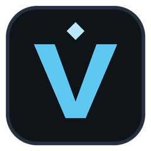

# VLite — lightweight Valorant tracker (Windows)

A single ~2,400-line Python file, no dependencies. Shows what the Tracker.gg app shows at its core:

- **Live** (agent select + in game). By default it shows each player's agent, name, rank, KD, last 5 games and your history with them. Tick **More stats** for every column below. For every teammate and opponent:
  - agent, name, level, rank + RR, peak rank, act win rate
  - recent form from their last 5 competitive games: KD, ACS, HS%, W/L. This fills in a few seconds after the lobby loads.
  - **Mains**: their most-played agents in those games, so you can plan comps in agent select.
  - **On this agent**: how they've done on the agent they're playing now, or "new pick".
  - **Played before**: whether you've met them, e.g. `With 2W 1L · Vs 0W 1L`
  - **Last met**: when and where, e.g. `3d ago · Ascent · Jett (vs)`
  - **Party**: players with the same coloured dot queued together. Your own party comes straight from Riot. For everyone else it's inferred: two players who were on the same team in 2+ of their last 5 competitive games are marked as a premade.
- Agent portraits, rank badges and the map banner are downloaded once from valorant-api.com and saved to `%LOCALAPPDATA%\VLite\img`. Rank names are built in, so they show even offline.
- **⚑ Flags**: your private notes on players ("threw", "AFK", "great duo"). Right-click anyone in the Live tab to flag them, or open **⚑ Flags** after a match to flag players from your last 3 lobbies. Flagged players show up in orange with your note when you meet them again. Only players whose names were visible can be flagged, and a flag never shows on someone who's hidden. Notes are stored only on your PC.
- **Me**: current rank/RR/peak, your **session** (W/L, RR, streak and KD for games less than 3 hours apart), a **rank-progress graph** of your last 20 competitive games (hover a point for details), and your last 20 matches with map, agent, result, score, K/D/A, KD, HS%, ACS and RR change. Double-click a match to see its **scoreboard**. Names show only for players VLite saw with visible names in that match.
- **Rank goal** (Me): RR to your next rank, how many wins that is at your average gain, and how many games at your current win rate.
- **Weekly report**: your last 7 days vs the week before (games, win rate, RR, KD, ACS, best map and agent). It shows on your first launch each week, or anytime from **☰ → Weekly report**.
- **Me → Maps & agents**: your competitive win %, KD, ACS and HS% per map and per agent, from every match saved on this PC. "Load 20 older matches" pulls in more history.
- **Team comp check** (agent select + in game): your team's roles, e.g. `2 Duelist · 1 Initiator · 1 Controller`, with warnings like "⚠ no controller" or "3 duelists". Hovered picks count, so you can plan before locking.
- **Agent pick tips** (agent select): which role your team still needs, and your best agent for it on this map from your own history, e.g. `Tip: your team still needs a Controller · your best pick: Omen, 68% WR on this map (9 games)`.
- **Free-for-all view** (Deathmatch): one list sorted by rank, with no ally/enemy split.
- **Map form**: your record on the current map (`You on Ascent: 64% WR · 1.21 KD (11 games)`), in the Live tab and overlay title.
- **Live round tracker** (in game): score, round number and each round's result, e.g. `7–5 · R13 · WWLWLW · sides switched`, plus match point and overtime. It reads the score the Riot Client already shares as your status. A live kill feed isn't available to outside tools without reading game memory, so your in-game Tab scoreboard is the place for that.
- **Rounds breakdown** (after the match): each round's result, how it ended, your kills (by agent), damage, loadout, and first blood, first death, plant, defuse or ace. Open it from a match's scoreboard or the recap.
- **Post-match recap**: after each game, a small card with your K/D/A, ACS, HS% and KD compared to your usual, your ACS rank on your team, and RR change.
- **Friends**: who's in a match (map, mode, score), in agent select, in menus (party size), away or playing another Riot game, with their rank. It's read from the Riot Client on your PC, like the in-game friends list.
- **Crosshairs**: save crosshair codes with names and copy one with a click. Paste it in VALORANT under Settings → Crosshair → Import Profile Code. VLite never changes game settings itself.
- **Store**: your daily offers and Night Market with prices, discounts and reset timers, plus your VP, Radianite and Kingdom Credits. It's only loaded when you click "Load my store".

"Played before" checks every match VLite has saved. On first launch that's your last 20 games, and it grows each time you play.

## Download (easiest)
1. Open **[Releases](https://github.com/AllenAJ/vLite/releases/latest)** and download **VLite.exe**.
2. Put it anywhere (Desktop, `C:\Games\VLite`, …) and double-click it. There's nothing to install, and Python isn't needed.
3. Windows SmartScreen may warn the first time because the exe isn't code-signed. Click **More info → Run anyway**.

Every exe is built and self-tested on a clean Windows machine by GitHub Actions (`.github/workflows/build.yml`) from the code in this repo.

## Build it yourself (optional)
1. Install Python 3.9+ from python.org (tick **Add python.exe to PATH**).
2. Put `vlite.py` and `build.bat` in one folder and double-click `build.bat`.
3. You get `dist\VLite.exe`. Copy it anywhere (Desktop, Start menu), pin it to the taskbar, and you can uninstall Python if you like.

Windows SmartScreen may warn the first time because the exe isn't code-signed. Click **More info → Run anyway**.
If you'd rather skip building, double-click `VLite.bat` to run it straight from Python.

## In-game overlay
- Set VALORANT to **Windowed Fullscreen** (Settings → Video → General → Display Mode). In **Fullscreen** mode the game takes over the screen and Windows can't show any window over it, Discord and OBS included. VLite reads VALORANT's settings and shows a warning bar if it's set to Fullscreen.
- Overlay still not showing? Click **Show / hide overlay** in VLite's window on the desktop first. If it appears there but not in game, the display mode is the cause. If it doesn't appear at all, send **☰ → Copy diagnostics**: it lists the display mode, the overlay state and your hotkey presses.
- Press **F6** in game to show or hide the overlay.
- **Compact overlay** (☰ → Settings → Overlay): one short line per player with party dot, agent, rank badge, KD and flag mark.
- **☰ → Settings → Overlay** lets you change the hotkey, corner, size (Small/Normal/Large), opacity, and which columns the overlay shows. Changes apply instantly and are remembered.
- The overlay is click-through and never takes focus, so your aim and keys stay in the game.
- **☰ → Settings → Behaviour**: show the overlay automatically in agent select, hide it when the match starts, pop it up when a flagged player is in your lobby, and show session stats in the overlay title.

## Tray, notifications, startup
- Closing the window keeps VLite running in the system tray (bottom-right, near the clock; it may sit under the ^ arrow). Click the icon to reopen it, or right-click for *Show / hide overlay* and *Quit VLite*.
- Windows notifications for **Match found** and **Flagged player in your lobby**. Windows' gaming Focus Assist can hold notifications while a game is fullscreen. The overlay alert still works.
- **Start VLite with Windows** is in Settings. It adds a normal per-user startup entry and doesn't need admin rights.
- All of these can be switched off in Settings.

## Updates
VLite checks GitHub for a newer release when it starts. If one exists, a bar at the top offers **Update now**: it downloads the new `VLite.exe`, swaps it in and restarts. You can turn this off or check manually in **☰ → Settings → App**.

## Something not working?
Open **☰ → Copy diagnostics** and paste the result into your bug report or message. It contains the VLite version, Windows version, your settings and the recent log, with player and match IDs removed. The full log is in `%LOCALAPPDATA%\VLite\vlite.log`.

## Ban safety
- No memory reading, injection, or graphics hooking. The overlay isn't drawn inside the game. It's a normal, transparent, always-on-top window, like a Discord or OBS window. The hotkey uses Windows' standard `RegisterHotKey` instead of a keyboard hook.
- Read-only. It only uses the local Riot Client API (lockfile) and the endpoints the official client uses. It never locks agents, sends chat, or changes settings.
- Players in incognito/streamer mode stay **Hidden**, and their rank is never fetched.
- One cheap local check every 5s while you're in menus. Ranks are cached for 10 min, and finished matches are cached on disk at `%LOCALAPPDATA%\VLite`.

These endpoints are unofficial, so Riot can change them at any time. Tools built this way aren't known to cause bans, but Riot doesn't guarantee that.
